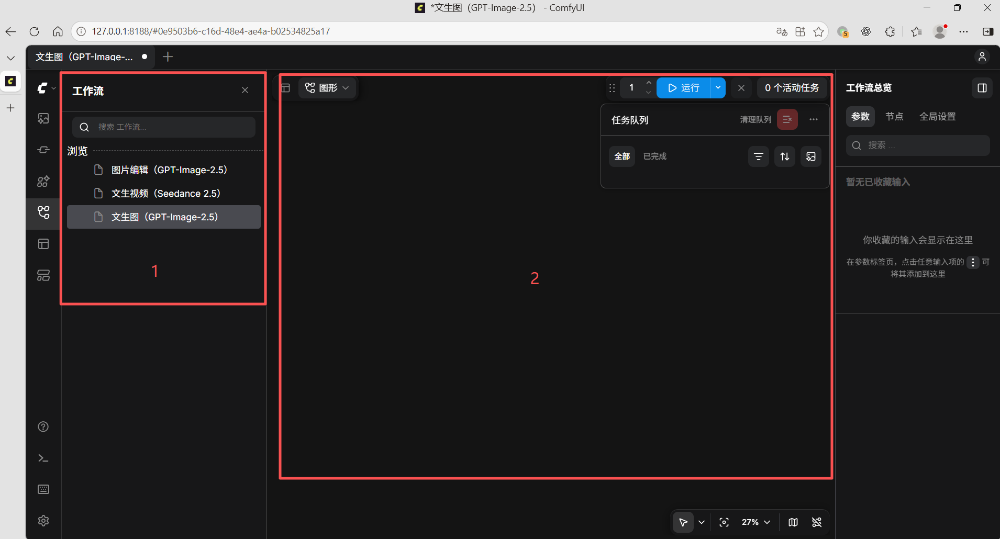
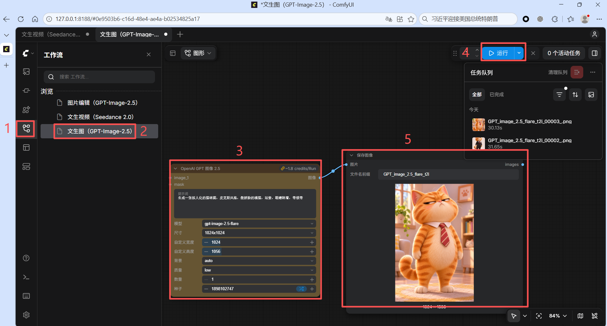
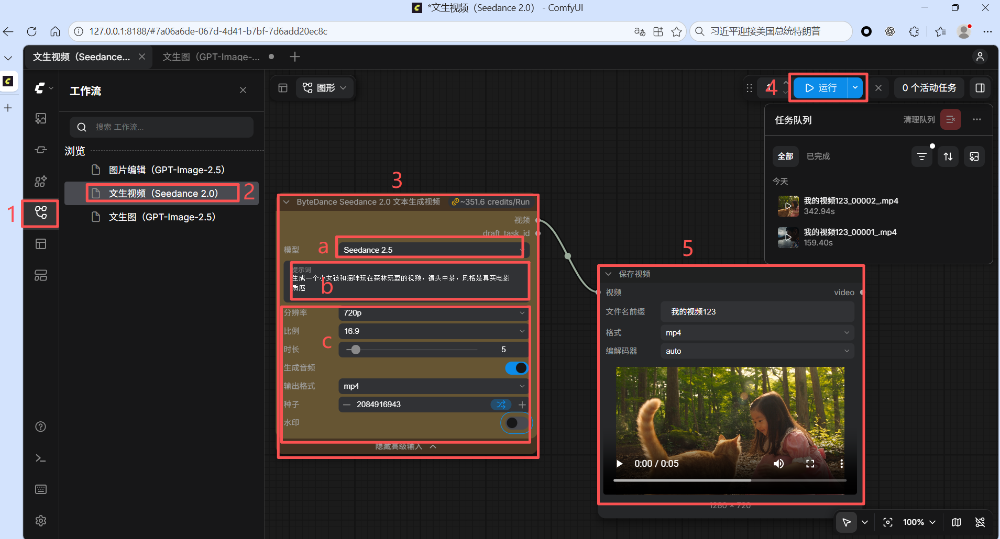
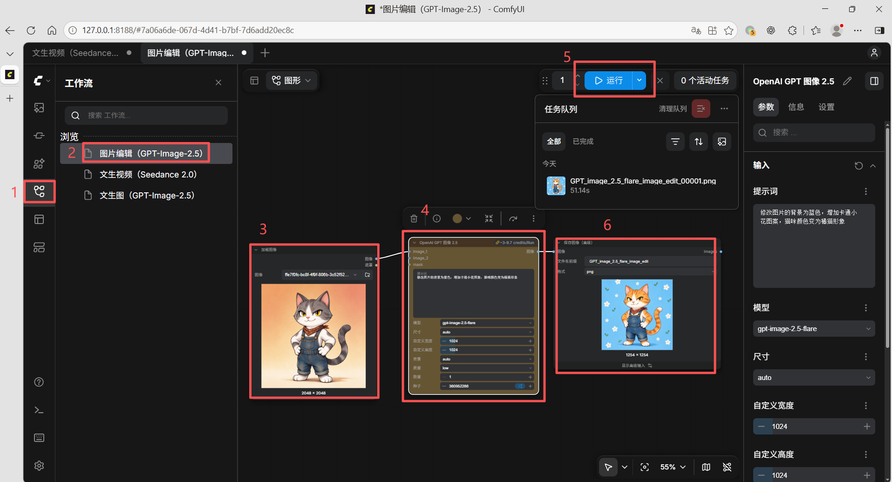

通过「AI 灵动」安装 ComfyUI 后，可以直接使用预设工作流，不用从零搭建节点。下面介绍安装方法和三种常用操作。

## 1. 安装并打开 ComfyUI

### 1.1 下载安装

1. 前往 [AI 灵动下载页](https://ailindo.com/software)，下载并安装 AI 灵动桌面版。
2. 打开 AI 灵动，在左侧选择「**AI 工具**」，找到 ComfyUI，点击「**安装 ComfyUI**」。

<Callout type="info" title="安装提示">
  ComfyUI 安装包较大，请保持网络畅通。如果安装失败，可以重试；若仍无法安装，可前往 [AI 灵动首页](https://ailindo.com/) 联系客服。
</Callout>

### 1.2 打开并认识界面

安装完成后，在 ComfyUI 卡片上点击「**打开**」，浏览器会自动打开 ComfyUI 页面。

1. **工作流列表**：从这里选择文生图、文生视频或图片编辑。
2. **画布**：选中工作流后，在这里查看节点、填写提示词和参数，以及查看生成结果。

## 2. 文生图：用文字生成图片

按截图中的编号操作：

1. **打开工作流列表**：点击左侧工具栏的「工作流」图标。
2. **选择工作流**：点击「**文生图（GPT-Image-2.5）**」。
3. **填写提示词**：在生图节点中描述主体、场景和风格。例如：一只戴领带的橘猫站在书店门口，暖色灯光，卡通风格。
4. **运行**：点击画布右上方的「**运行**」。
5. **查看结果**：在「保存图像」节点查看输出。如果不满意，返回第 3 步修改提示词，再运行一次。

## 3. 文生视频：用文字生成视频

按截图中的编号操作：

1. **打开工作流列表**：点击左侧工具栏的「工作流」图标。
2. **选择工作流**：点击「**文生视频**」（图中为 Seedance 2.0）。
3. **配置视频生成节点**：
   - **a. 选择模型**：在下拉菜单中选择需要的 Seedance 模型。
   - **b. 填写提示词**：描述主体、动作和镜头。例如：一只猫在树林里追蝴蝶，镜头缓慢跟拍，写实电影风格。
   - **c. 设置参数**：按需设置分辨率、比例、时长和是否生成音频。若提示词与节点参数冲突，以节点参数为准。
4. **运行**：点击画布右上方的「**运行**」。
5. **查看结果**：在「保存视频」节点查看输出。如果不满意，返回第 3 步调整提示词或参数，再运行一次。

## 4. 图生图：编辑已有图片

按截图中的编号操作：

1. **打开工作流列表**：点击左侧工具栏的「工作流」图标。
2. **选择工作流**：点击「**图片编辑（GPT-Image-2.5）**」。
3. **上传原图**：在「加载图像」节点选择要修改的图片。
4. **填写修改要求**：在生图节点的提示词框中写清楚要改什么、要保留什么。例如：把背景改成蓝色，加上卡通小花，保留猫的姿势和服装。
5. **运行**：点击画布右上方的「**运行**」。
6. **查看结果**：在「保存图像」节点查看修改后的图片。如果不满意，返回第 4 步调整修改要求，再运行一次。
