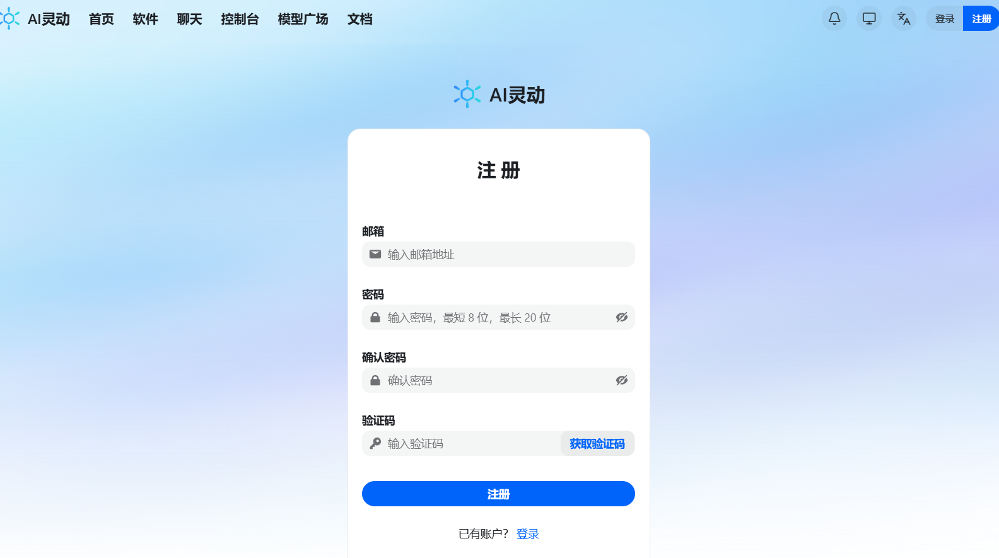
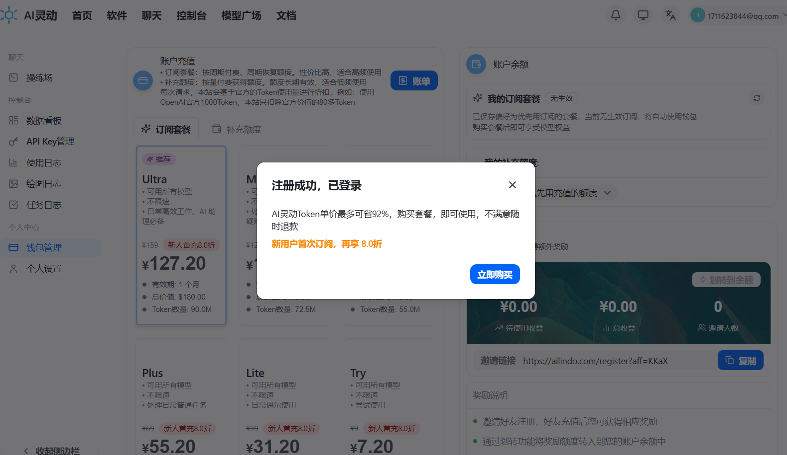
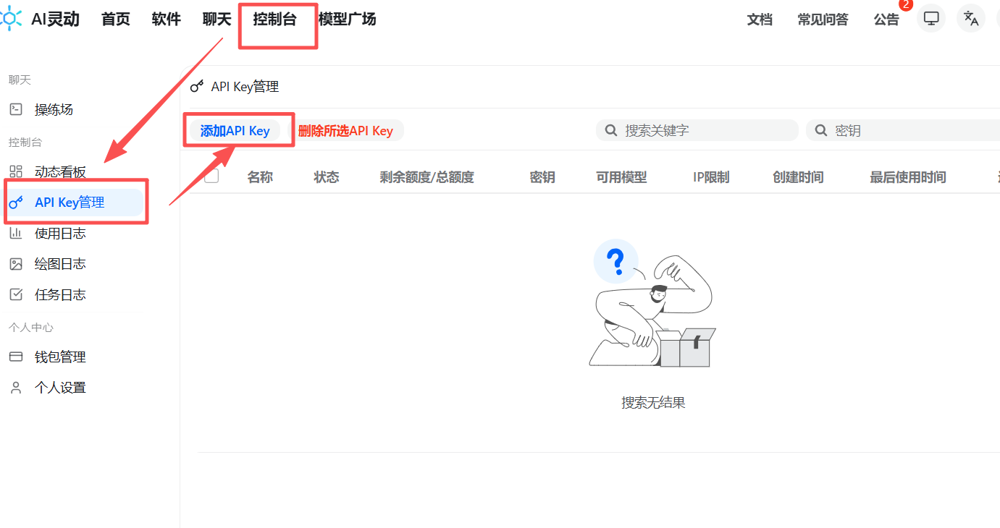
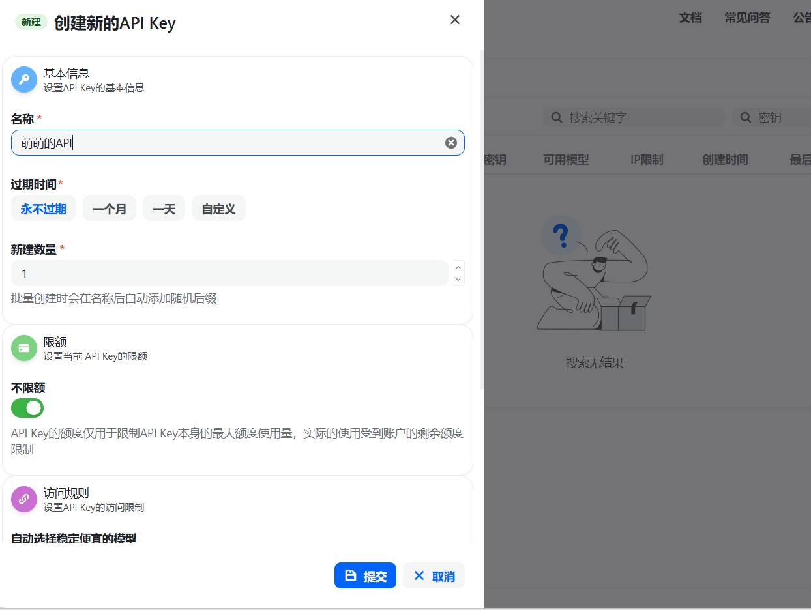
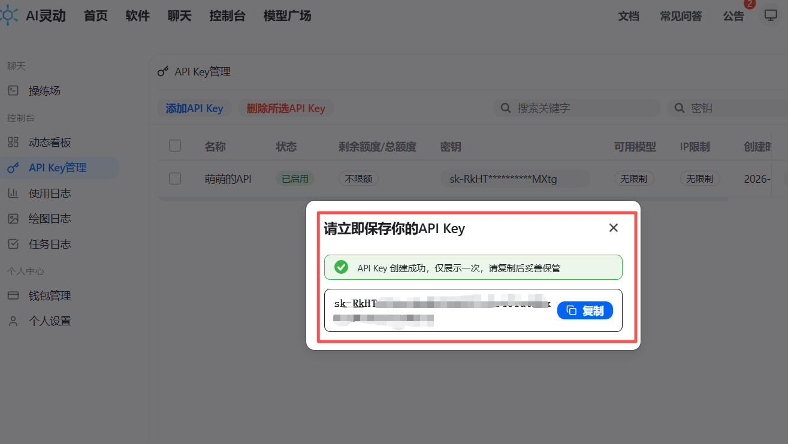
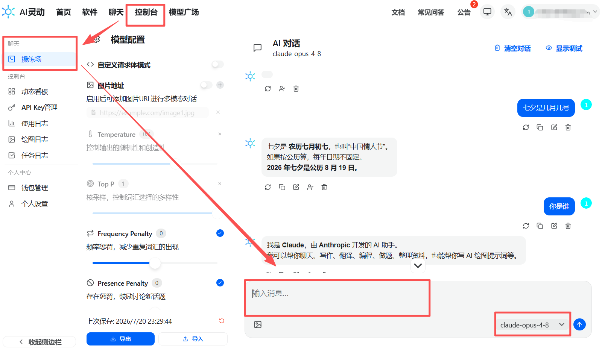
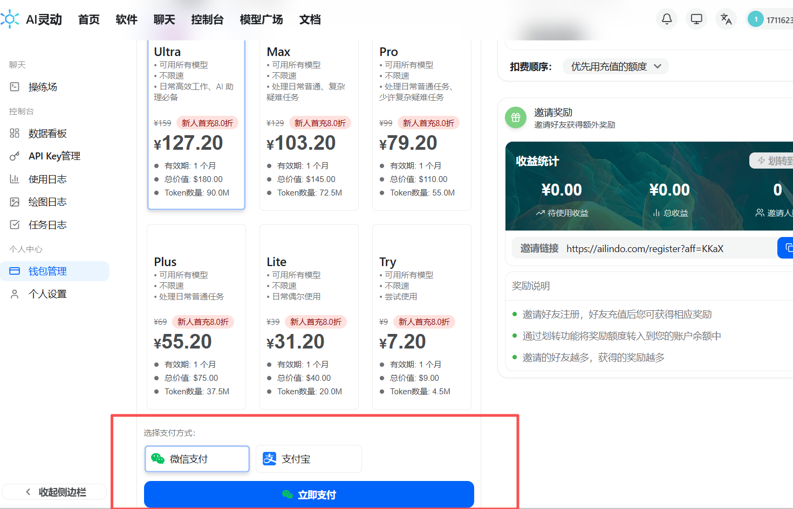
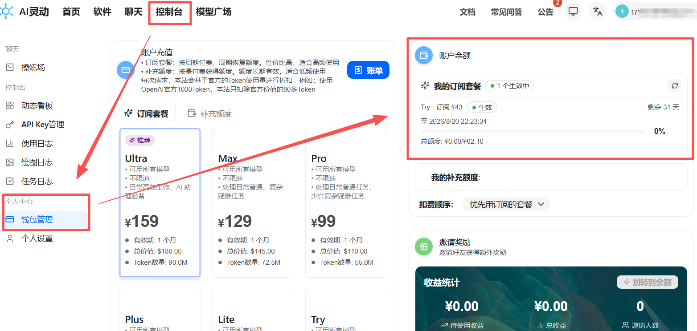

本指南带你从零开始上手「AI 灵动」：注册账号、获取 API 密钥、配置常见的 AI 工具，最后完成充值订阅，即可使用 opus、gpt、DeepSeek、glm 等最新模型。

## 第一步：注册并自动登录

1、 点击[注册](https://ailindo.com/register)，进入注册页面。

2、注册成功后，会自动登录

## 第二步：获取 API Key

API Key是你调用 AI 模型的「通行证」，生成后请妥善保存。

1. 在控制台中找到「**API Key 管理**」，点击「**添加 API key**」

2. 填写信息，可自定义填写「API 名称」「过期时间」「数量」，其他保持默认选项即可，填写完成点击「**提交**」

3. 系统会生成一串类似 `sk-xxxxxxxxxxxxxxxx` 的密钥，立即复制并保存到安全的地方（关闭页面后无法再次查看）

<Callout type="warn" title="注意">
  1. 请勿将 API 密钥泄露给他人，否则可能被盗用。
  2. 如嫌生成 API 密钥麻烦，可下载 AI 灵动软件，自动生成 API 密钥可直接使用。
</Callout>

import { Card, Cards } from 'fumadocs-ui/components/card';

## 第三步：配置 AI 工具

### 使用 AI 灵动软件，自动配置（强烈推荐 ⭐⭐⭐⭐⭐）

AI 灵动软件集成了市面上主流的 AI 工具，一键安装、自动配置好所有环境，无需折腾代码和命令行，下载即用。

详细教程请参考：[https://docs.ailindo.com/zh/docs/usage-tutorial/ailindo](https://docs.ailindo.com/zh/docs/usage-tutorial/ailindo)

软件核心优势：

- **下载即用**：无需折腾代码和环境，安装即可使用
- **自动配置**：所有工具一键集成，无需手动配置任何参数
- **图形化操作**：全部在可视界面中完成，点点鼠标就行
- **一键切换**：想用哪个 AI 工具直接切换，不用改任何配置

各 AI 工具的手动配置详细图文教程，如下：

<Cards>
  <Card
    title="配置 Claude Code"
    description="安装 Node.js、理解配置本质，在 macOS / Windows 写入配置文件并验证可用。"
    href="/zh/docs/usage-tutorial/ailindo-claude-code"
  />
  <Card
    title="配置 Codex"
    description="macOS 与 Windows 两套步骤，编辑 config.toml、粘贴配置、重启与测试验证。"
    href="/zh/docs/usage-tutorial/ailindo-codex"
  />
  <Card
    title="配置 Trae"
    description="在 Trae 中添加自定义模型，填写请求地址与密钥，选择模型开始对话。"
    href="/zh/docs/usage-tutorial/ailindo-trae"
  />
  <Card
    title="配置 WorkBuddy"
    description="在 WorkBuddy 中添加自定义模型，填写接口地址与密钥，选择模型开始对话。"
    href="/zh/docs/usage-tutorial/ailindo-workbuddy"
  />
</Cards>

### 备选：直接在 AI 灵动网页上聊天

1. 登录后，点击顶部导航栏的「**控制台**」-「**操练场**」
2. 在文本框右下角选择你想要使用的模型
3. 输入问题，即可与 AI 对话

## 第四步：充值订阅套餐

配置好工具后，需要充值才能正常使用。 **新户首充享八折优惠！选大套餐更省钱。**

点击 [立即充值](https://ailindo.com/console/topup)，进入充值页面。

充值成功后，即可在「**控制台 - 钱包管理 - 账户余额**」查看账户余额。

