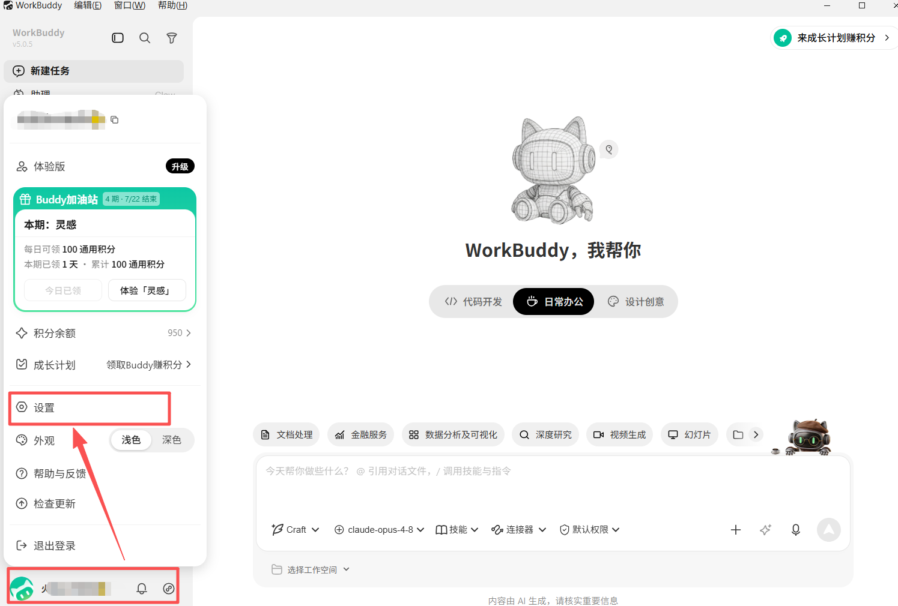
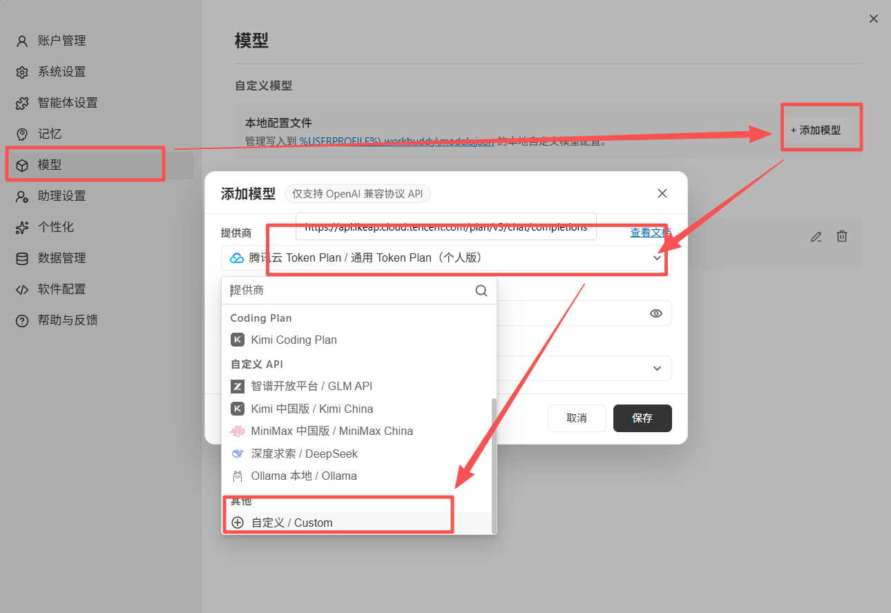
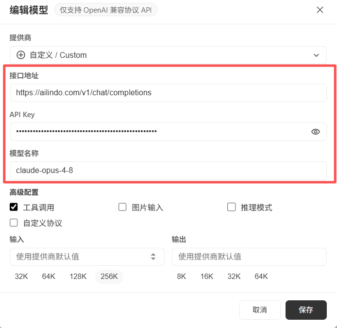
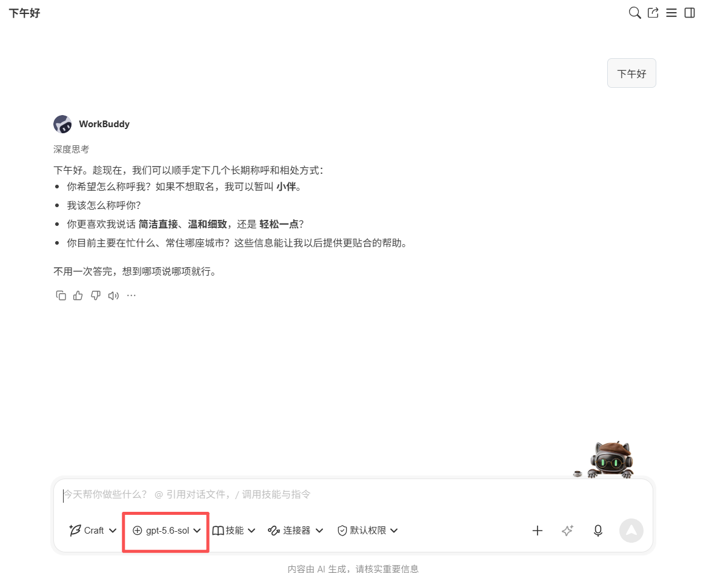

本文介绍如何用「AI 灵动」的 API 密钥在 WorkBuddy 中配置自定义模型。如果还没有 API 密钥，请先阅读 [AI 灵动 新手指南](/zh/docs/usage-tutorial/ailindo-guide) 完成注册并获取密钥。

## 1. 登录，找到设置

单击左下角账户图标，选择「**设置**」。

## 2. 添加自定义模型

在左侧中找到「**模型**」，如图，选择「**自定义 / custom**」。

填写以下信息：

- **接口地址**：（注意：WorkBuddy 支持的是 OpenAI 格式 `/v1/chat/completions`）

- **API Key**：粘贴你保存的密钥
- **模型名称**：填写模型名称

## 3. 测试验证

在 WorkBuddy 的对话框选择模型对话，如正常回复，说明配置成功。

